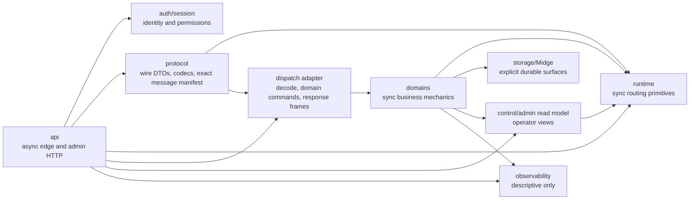
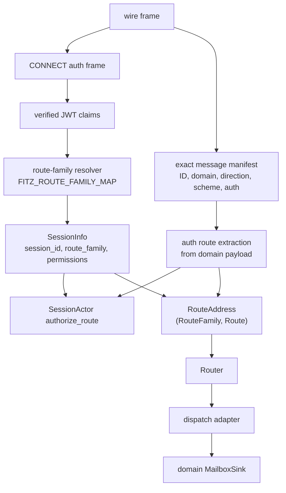

# Fitz Code Architecture Modules

**Status**: Source-structure reference
**Scope**: Rust broker workspace under `crates/`

This document describes how the code is organized. It is not a replacement for
the domain contracts in [domain-boundaries-spec.md](domain-boundaries-spec.md)
or the behavioral diagrams in
[architecture-diagrams.md](architecture-diagrams.md).

## Top-Level Module Map

```mermaid
flowchart TB
    subgraph BOOT["fitz-server boot"]
        BOOTMOD["api/broker.rs<br/>startup and shutdown orchestration"]
        BOOTRT["runtime/<br/>BootConfig and env parsing"]
        BOOTDOM["domains.rs<br/>domain sink construction"]
        BOOTSTOR["api/storage_runtime.rs<br/>Midge engine open"]
    end

    subgraph API["fitz-server API"]
        HANDLERS["handlers/<br/>HTTP, TCP, WebSocket listeners"]
        INGRESS["runtime_ingress/<br/>auth, session registry, domain dispatch"]
        ADMIN["admin/<br/>operator APIs, assets, metrics, topology"]
        MCP["mcp/<br/>tool-facing API surface"]
        OUTBOUND["outbound.rs<br/>session response delivery"]
    end

    subgraph AUTHSESSION["fitz-server auth and session"]
        AUTH["src/auth<br/>JWT, claims, permissions, route-family resolver"]
        SESSION["src/session<br/>session actor and permission checks"]
    end

    subgraph PROTO["wire handling"]
        MESSAGE["fitz-core framing<br/>message.rs and wire2"]
        CODECS["domain crate codecs<br/>kv, notice, queue, rpc, lease, stream, schedule"]
        DISPATCH["fitz-server dispatch adapter<br/>decode, commands, responses"]
    end

    subgraph RUNTIME["fitz-core runtime"]
        ROUTING["routing.rs<br/>RouteFamily, Route, RouteAddress"]
        ROUTER["router.rs<br/>MailboxSink delivery"]
        MANIFEST["protocol/manifest.rs<br/>exact message IDs and authorization"]
        ACTORS["family_actor_pool.rs, actor.rs, mailbox.rs"]
        EVENTS["domain_event.rs<br/>DomainPublishEvent, SessionCleanup"]
    end

    subgraph DOMAINS["domain crates"]
        KV["kv"]
        QUEUE["queue"]
        NOTICE["notice"]
        STREAM["stream"]
        RPC["rpc"]
        LEASE["lease"]
        SCHEDULE["schedule"]
        SUBSTATE["fitz-core subscription_state.rs<br/>shared routed subscription set"]
    end

    subgraph SUPPORT["supporting code"]
        STORAGE["fitz-storage wrapper<br/>FitzStorageEngine"]
        CONTROL["fitz-server control<br/>admin read model and health models"]
        OBS["fitz-server observability<br/>metrics and tracing helpers"]
        TESTKIT["crate test fixtures and fitz-server benchkit"]
        CLIENT["fitz-server client"]
    end

    BOOTMOD --> BOOTRT
    BOOTMOD --> BOOTSTOR
    BOOTMOD --> BOOTDOM
    BOOTMOD --> HANDLERS
    BOOTDOM --> KV
    BOOTDOM --> QUEUE
    BOOTDOM --> NOTICE
    BOOTDOM --> STREAM
    BOOTDOM --> RPC
    BOOTDOM --> LEASE
    BOOTDOM --> SCHEDULE
    BOOTDOM --> ROUTER
    BOOTSTOR --> STORAGE

    HANDLERS --> INGRESS
    INGRESS --> AUTH
    INGRESS --> SESSION
    INGRESS --> MESSAGE
    INGRESS --> CODECS
    INGRESS --> DISPATCH
    INGRESS --> ROUTER
    INGRESS --> MANIFEST
    INGRESS --> OUTBOUND

    CODECS --> DISPATCH
    DISPATCH --> KV
    DISPATCH --> QUEUE
    DISPATCH --> NOTICE
    DISPATCH --> STREAM
    DISPATCH --> RPC
    DISPATCH --> LEASE
    DISPATCH --> SCHEDULE
    KV --> ROUTING
    QUEUE --> ROUTING
    NOTICE --> ROUTING
    STREAM --> ROUTING
    RPC --> ROUTING
    LEASE --> ROUTING
    SCHEDULE --> ROUTING
    KV --> STORAGE
    QUEUE --> STORAGE
    STREAM --> STORAGE
    SCHEDULE --> STORAGE
    KV --> CONTROL
    QUEUE --> CONTROL
    NOTICE --> CONTROL
    STREAM --> CONTROL
    RPC --> CONTROL
    LEASE --> CONTROL
    SCHEDULE --> CONTROL
    KV --> OBS
    QUEUE --> OBS
    NOTICE --> OBS
    STREAM --> OBS
    RPC --> OBS
    LEASE --> OBS
    SCHEDULE --> OBS

    ADMIN --> CONTROL
    ADMIN --> OBS
    MCP --> CONTROL
    MCP --> OBS
    TESTKIT --> HANDLERS
    TESTKIT --> KV
    CLIENT --> MESSAGE
```

## Dependency Shape

Important boundaries:

- `fitz-server` owns async I/O and the async/sync transition in `src/api`.
- `fitz-core` owns synchronous routing primitives, framing, message IDs, error
  encoding, and the exact message manifest.
- Each domain crate owns its payload codec and domain mechanics. It uses core
  runtime types for addressing and delivery.
- `fitz-server` applies authorization policy using the exact message manifest
  and session permissions.
- The dispatch adapter is the only runtime seam that turns protocol values
  into synchronous domain commands and turns domain responses back into frames.
- `fitz-server` exposes read models and operator views in `src/control` and
  `src/api/admin`. These views reflect runtime and domain state.
- `fitz-server` records metrics and traces in `src/observability`. Broker
  behavior is independent of whether observability is enabled.

## Route And Dispatch Ownership

The route family is session state. The realm is route text. Code that needs both
must carry both explicitly through `RouteAddress`.
